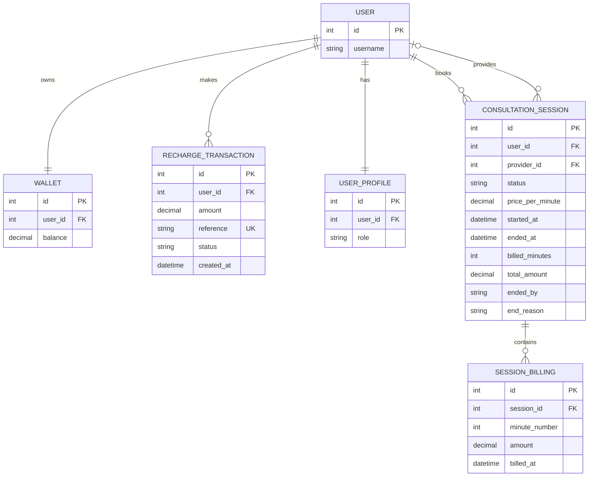

# Entity-Relationship (ER) Diagram

## Database Relationships

## Constraints

- Each wallet belongs to one user.
- Each user has one profile with a role such as `USER` or `PROVIDER`.
- Recharge references are unique.
- Each consultation session belongs to a user and may have an assigned provider.
- Each session can have multiple billing records.
- The combination of session and minute number is unique in `SessionBilling`, preventing duplicate records for the same billed minute.
