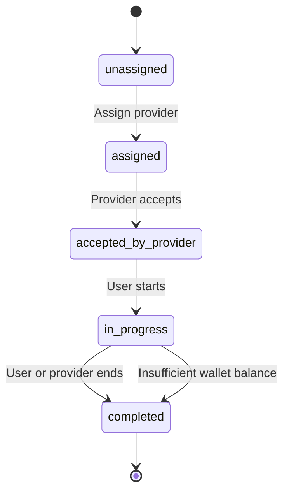

# Consultation Session State Diagram

## Session States

- `unassigned` — Session has been created but not assigned to a provider.
- `assigned` — A provider has been assigned to the session.
- `accepted_by_provider` — The assigned provider has accepted the session.
- `in_progress` — The user has started the session.
- `completed` — The session has ended, either manually or automatically.

## State Transitions

## Transition Rules

| Current state | Action | Next state |
|---|---|---|
| `unassigned` | Assign provider | `assigned` |
| `assigned` | Provider accepts | `accepted_by_provider` |
| `accepted_by_provider` | User starts | `in_progress` |
| `in_progress` | User or provider ends | `completed` |
| `in_progress` | Wallet cannot cover next minute | `completed` |

Invalid transitions must return HTTP 400 with a meaningful error message.

## Automatic Termination

When the wallet cannot cover the next billable minute, the system completes the session with:

- `ended_by = system`
- `end_reason = Insufficient balance`

The wallet must never become negative, and an unaffordable minute must not be charged.
